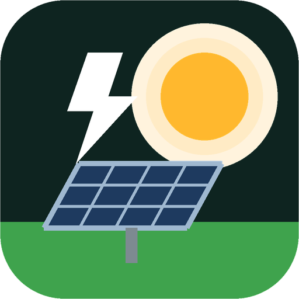
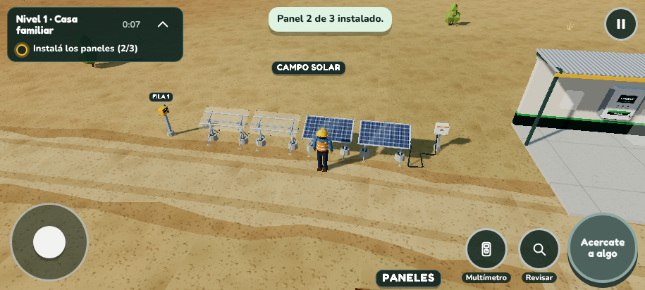
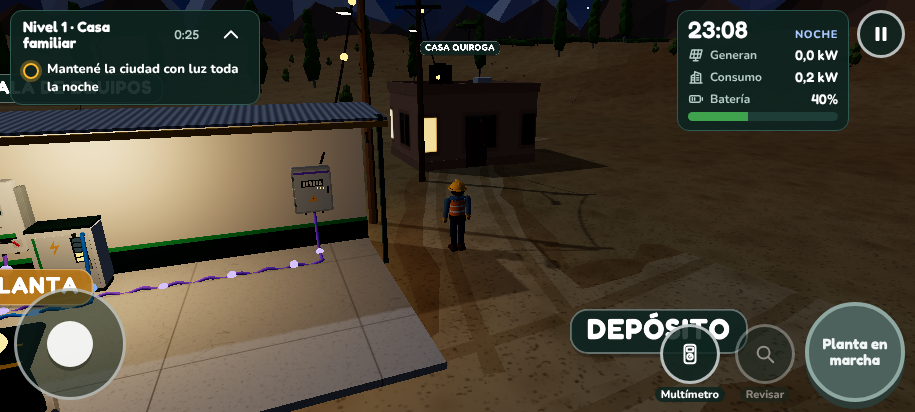
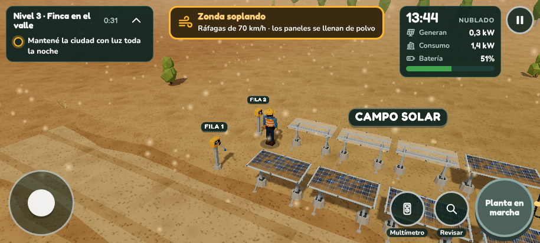
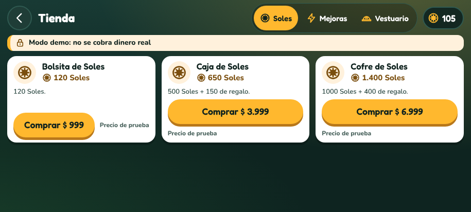

<p align="center"></p>

# Misión Energía

Juego para Android: armá una **planta solar híbrida** en San Juan, conectá paneles, protección, inversor, baterías y tablero, y mantené la ciudad con luz toda la noche.

**[Descargar MisionEnergia.apk](https://github.com/dveronm21/mision-energia/releases/latest/download/MisionEnergia.apk)** · Android 7 o superior · funciona sin internet

<p align="center"></p>

<p align="center">




</p>

## Cómo instalar

1. Abrí el archivo `MisionEnergia.apk` descargado.
2. Si Android pregunta, tocá **Configuración → Permitir de esta fuente**.
3. Si aparece Play Protect: **Más detalles → Instalar de todas formas** (pasa con las apps que no vienen de Play Store).
4. Abrí **Misión Energía** y jugá en horizontal.

## Qué tiene

- 5 niveles: Casa familiar, Escuela rural, Finca con bombeo, Pueblo y Parque solar.
- Taller con presupuesto, armado en 3D con joystick, 3 cables con reglas reales, multímetro, viento Zonda y simulación día/noche.
- **Soles**, la moneda del juego: se ganan con estrellas, regalo de bienvenida y bono diario, y se usan en mejoras (pista, dron limpiador, batería de emergencia, presupuesto extra), vestuario y desbloqueo anticipado de niveles.
- Tienda de packs de Soles en **modo demo** (no cobra dinero real), con control parental. Los pagos reales se conectan después con `MercadoPagoProvider` o Google Play Billing, validando cada compra en un servidor.

## Desarrollo

```
app/        juego (TypeScript + three.js, esbuild)
  src/contracts.ts   interfaces entre módulos
  src/core           guardado, eventos, audio
  src/sim            simulador energético, clima, puntaje
  src/levels         niveles y progreso
  src/economy        Soles, inventario, tienda, pagos
  src/world          mundo 3D, entidades, interacción
  src/world/assets   modelos, materiales, ambiente, render
  src/ui             HUD y pantallas
  src/app            composición y navegación
  tests/             tests unitarios y de balance
  e2e/               partida automática con Playwright
android/    contenedor WebView nativo y build.sh
```

```bash
cd app && npm ci
npm run typecheck && npm test && npm run balance
npm run build                       # genera app/dist
KS=/ruta/keystore.jks KS_PASS=... ../android/build.sh
```

**Publicar una versión:** subí `versionCode` y `versionName` en `android/AndroidManifest.xml` y `version` en `app/package.json`, y creá el tag `vX.Y.Z`. GitHub Actions compila, firma y publica el APK en Releases. Usa los secretos `KEYSTORE_B64` y `KS_PASS`. El enlace del QR siempre baja la última versión.

Hecho por Inkfusion · San Juan, Argentina.
